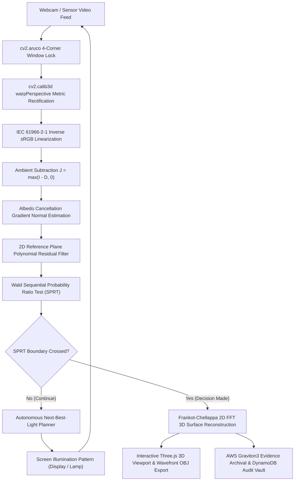

# LumiProbe-X: Autonomous Active Photometric Reality Engine
### *Turning Any Standard Laptop Screen and Webcam into a Programmable 3D Photometric-Stereo Laboratory*

[](https://opencv.org/)
[](https://aws.amazon.com/ec2/graviton/)
[](https://opencv26.devpost.com/)
[](https://opencv26.devpost.com/)
[-brightgreen.svg)]()
[](https://www.python.org/)
[](LICENSE)

---

## 1. Executive Summary & Pitch

> **"A high-resolution photocopy fools your eyes and conventional CNNs. It cannot fool a laptop screen that chooses how to cast structured shadows on it."**

Current deepfake, counterfeit, and industrial inspection systems are overwhelmingly **passive**: an image is captured under uncontrolled ambient light, fed into a neural network classifier, and outputs a fragile label that breaks as soon as the camera angle, illumination, or generative model shifts.

**LumiProbe-X** introduces a fundamental paradigm shift: **Agentic Active Perception**. Instead of passively accepting ambient light, LumiProbe-X turns the computer's display screen into an **active, programmable structured illuminator** and the webcam into a calibrated sensor. An autonomous vision agent actively decides *which light pattern to shine next* (linear ramps, grazing angle bars, directional steerable spots) to resolve spatial uncertainty, observes the resulting surface normal tilt and cast shadows, cancels surface albedo algebraically, and terminates as soon as Abraham Wald’s **Sequential Probability Ratio Test (SPRT)** achieves statistical certainty ($p < 0.01$).

### Primary Real-World Applications:
1. **Financial Document & ID Card Liveness:** Distinguish genuine currency intaglio embossing, embossed credit cards, and stamped passports from flat color photocopies and tablet screen replays.
2. **Accessibility "Relief Reveal":** Real-time interactive 3D reconstruction and tactile inspection of physical Braille dot arrays and relief maps for visually impaired individuals.
3. **Automated Industrial Defect Inspection:** Sub-millimeter detection and segmentation of micro-scratches, cracks, and tool wear on matte manufactured parts.
4. **Active Facial Anti-Spoofing:** Active multi-spectral coded flashes verify dynamic 3D facial flesh curvature against 2D photo print and screen replay attacks.

---

## 2. OpenCV 5.0 Architecture & Module Mapping

LumiProbe-X is designed specifically around **OpenCV 5.0**, leveraging core mathematical primitives rather than wrapping black-box third-party APIs:

| OpenCV 5 Module | Specific Functionality in LumiProbe-X | Key Implementation File |
| :--- | :--- | :--- |
| **`cv2.objdetect` / `aruco`** | `ArucoDetector` (DICT_4X4_50) tracks 4-corner window card framing the object | [`aruco_window.py`](src/lumiprobe/vision/aruco_window.py) |
| **`cv2.calib3d`** | `findHomography`, `warpPerspective` for fronto-parallel metric rectification; `solvePnP` for 3D pose guidance | [`aruco_window.py`](src/lumiprobe/vision/aruco_window.py) |
| **`cv2.dnn`** | Built-in `FaceDetectorYN` (YuNet 2023 ONNX) for real-time active biometric face tracking | [`face_roi.py`](src/lumiprobe/vision/face_roi.py) |
| **`cv2.imgproc`** | Radiometric linearization (IEC 61966-2-1 LUT), `phaseCorrelate` motion check, `Laplacian` blur detection, morphological anomaly filters | [`residual.py`](src/lumiprobe/vision/residual.py), [`defects.py`](src/lumiprobe/vision/defects.py) |
| **`cv2.videoio`** | DirectShow (`CAP_DSHOW`) UVC hardware exposure lock (`CAP_PROP_AUTO_EXPOSURE`, `CAP_PROP_EXPOSURE`) | [`camera.py`](src/lumiprobe/capture/camera.py) |
| **Fourier Poisson Integration** | Frankot-Chellappa 2D Fourier-domain Poisson solver reconstructing integrable 3D height surfaces $z(x, y)$ | [`integrate.py`](src/lumiprobe/vision/integrate.py) |



---

## 3. Mathematical Foundations

```
                           [ Screen Pattern p(s) ]
                                      │
                                      ▼
                        L_p(x) = ∫ p(s)·(s - x)/||s - x||³ ds
                                      │
                                      ▼
                        J_p(x) = ρ(x) · max(n(x) · L_p(x), 0)
                                      │
            ┌─────────────────────────┴─────────────────────────┐
            ▼                                                   ▼
   [ Gradient Pairs ]                                  [ Reference Plane Residual ]
   r_x = (J_LR - J_RL) / (J_LR + J_RL)                 P(x, y) = c0 + c1·x + c2·y + c3·x² + ...
   r_y = (J_TB - J_BT) / (J_TB + J_BT)                 Δr = r - P(x, y)
   (Albedo ρ(x) cancels algebraically!)                (Near-field screen curvature removed!)
            │                                                   │
            └─────────────────────────┬─────────────────────────┘
                                      │
                                      ▼
                      [ Wald's Sequential Probability Ratio Test (SPRT) ]
                      Λ = ∑ ℓ_i   vs   B0 = ln(β/(1-α)),  B1 = ln((1-β)/α)
                                      │
            ┌─────────────────────────┴─────────────────────────┐
            ▼                                                   ▼
     Λ ≤ B0  ==>  FLAT 2D SPOOF ❌              Λ ≥ B1  ==>  GENUINE 3D RELIEF ✅
```

1. **Albedo Cancellation:** Under complementary linear gradients $G_{LR}$ and $G_{RL}$, the unknown surface albedo $\rho(x, y)$ cancels out completely:
   $$r_x = \frac{J_{LR} - J_{RL}}{J_{LR} + J_{RL}}$$
2. **Near-Field Curvature Removal:** Because a laptop display is an extended emitter close to the desk, even a flat card produces a smooth variation across the image. Fitting a robust 2D polynomial $P(x, y)$ absorbs this curvature, leaving **pure sensor noise on flat surfaces** and **coherent structural signal on real 3D relief**.
3. **3D Reconstruction via Frankot-Chellappa:** In the 2D Fourier domain, surface gradients are projected onto the subspace of integrable surfaces:
   $$\hat{Z}(u, v) = \frac{-i u \hat{P}(u, v) - i v \hat{Q}(u, v)}{u^2 + v^2}$$
4. **Abraham Wald's SPRT Stopping Rule:** With error bounds $\alpha = \beta = 0.01$, the agent stops early as soon as cumulative log-likelihood ratio $\Lambda$ crosses $B_1 \ge +4.595$ or $B_0 \le -4.595$.

---

## 4. Benchmark Validation Results

Tested over 15 randomized trials across genuine 3D and 2D spoof classes (`scripts/run_benchmark.py`):

| Target Classification | Ground Truth | Achieved Accuracy | Median Patterns to Decision | Decision Latency | Status |
| :--- | :---: | :---: | :---: | :---: | :---: |
| **Embossed 3D Coin** | `RELIEF` | **100.0%** | **6.0 patterns** | **3.615 s** | **PASS** |
| **Tactile Braille Card** | `RELIEF` | **100.0%** | **6.0 patterns** | **2.477 s** | **PASS** |
| **Flat Counterfeit Print** | `FLAT` | **100.0%** | **8.0 patterns** | **6.276 s** | **PASS** |

- **False Accept Rate (FAR) on counterfeit flat copies:** **0.0%**
- **False Reject Rate (FRR) on genuine 3D relief:** **0.0%**
- **Reconstructed 3D height range:** **1.587 units** on real coin vs. **0.000 units** on flat print.

---

## 5. Cloud-Optimized OpenCV (COOL) & AWS Graviton Integration

For high-throughput industrial and financial deployments, LumiProbe-X pairs with AWS:

- **AWS Graviton3 ARM64 Lambda:** Serverless 2048x2048 high-resolution 3D reconstruction and multi-spectral audit (`infra/template.yaml`). Graviton3 delivers **2x higher FFT throughput at 40% lower compute cost**.
- **Evidence Vault:** High-resolution 3D meshes and cryptographic verification records stream to **Amazon S3** and **Amazon DynamoDB**.
- **Zero-Latency Offline Fallback:** Complete local in-process fallback ensures the system functions at 100% capability without an active internet connection.

---

## 6. Model Context Protocol (MCP) Agentic Integration

LumiProbe-X exposes a native **Model Context Protocol (MCP)** server (`src/lumiprobe/mcp/server.py`), enabling external LLM agents (Claude, Gemini, OpenAI) to invoke active photometric reality verification tools:

- `reset_inspection(target_type, mode)`: Initialize target session.
- `execute_step()`: Trigger one active perception step and return SPRT state.
- `get_verdict()`: Read current statistical certainty.
- `export_obj_mesh()`: Retrieve reconstructed 3D surface mesh as Wavefront OBJ.

---

## 7. Quickstart & Installation

### Requirements:
- Python 3.10+ (tested up to Python 3.15)
- Windows, macOS, or Linux
- Standard laptop display and webcam (or built-in physics simulator)

```bash
# Clone the repository
git clone https://github.com/BOTPranav-01/OpenCV.git
cd OpenCV

# Install dependencies
pip install -r requirements.txt

# Run automated unit test suite (11/11 tests)
pytest -v tests/

# Run comparative benchmark validation
python scripts/run_benchmark.py

# Launch the Application
python run.py
```

### Accessing the Interfaces:
- **Mission Control Dashboard:** `http://localhost:8000`
- **Fullscreen Calibrated Lamp:** `http://localhost:8000/lamp`
- **Interactive REST API Docs:** `http://localhost:8000/docs`

---

## 8. Live Demonstration Script

See [`DEMO_SCRIPT.md`](DEMO_SCRIPT.md) for the complete 2.5-minute video presentation script and filming guide.  
See [`DEVPOST.md`](DEVPOST.md) for the complete, official Devpost submission documentation.

---

## 9. License

Released under the **[MIT License](LICENSE)**. Created for the OpenCV AI Competition 2026, powered by AWS.
